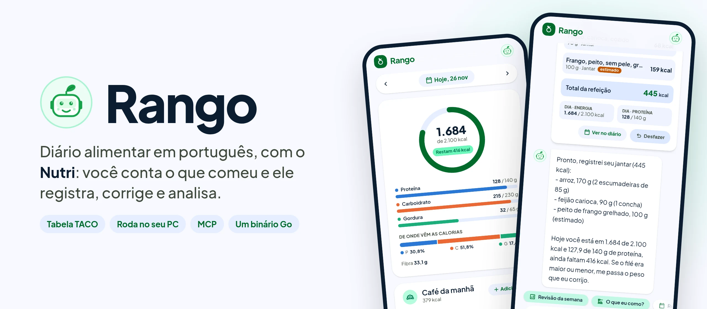
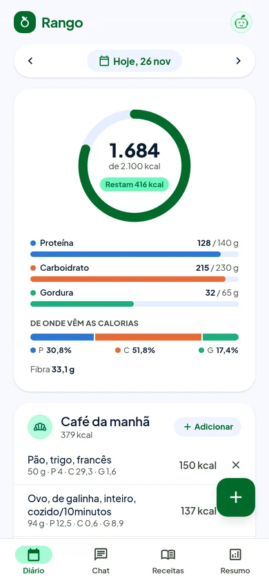
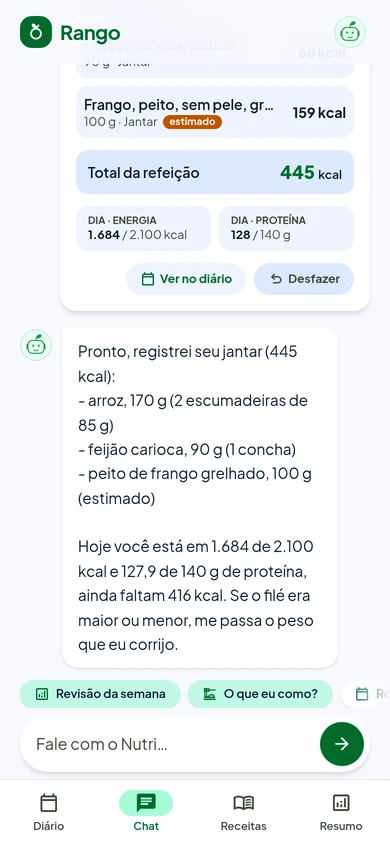
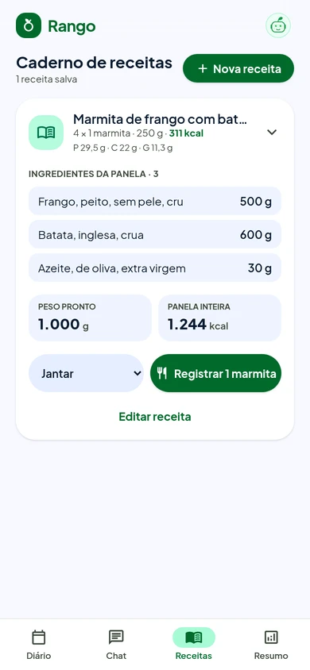
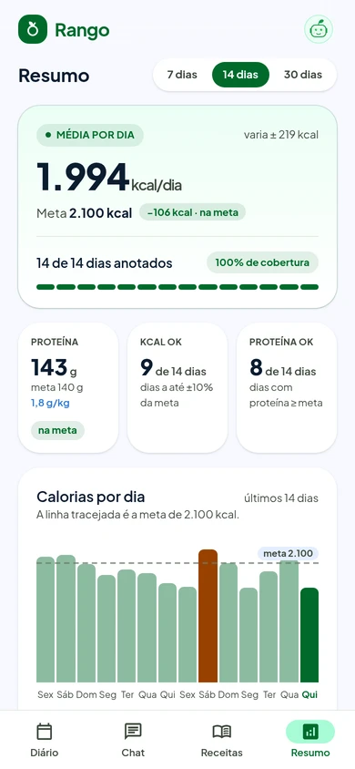

<div align="center">

<picture>
  <source media="(prefers-color-scheme: dark)" srcset="design/readme/banner-escuro.webp">
  
</picture>

<br><br>

**Diário alimentar local, leve e em português.<br>Você conta o que comeu, o Nutri registra, e o app faz as contas.**

[](go.mod)
[](#use-o-mcp-em-outros-clientes)
[](#dados-e-créditos)
[](LICENSE)

[O que faz](#o-que-faz) · [Telas](#telas) · [Instalação](#instalação) · [Uso](#uso) · [Docker](#docker) · [MCP](#use-o-mcp-em-outros-clientes) · [Desenvolvimento](#desenvolvimento) · [Plano](PLANO.md)

</div>

<br>

Fale com o Nutri como falaria com alguém:

- *"almocei um prato de arroz, uma concha de feijão e um bife"*
- *"na verdade foram 200 g"* ou *"desfaz o último"*
- *"fiz 4 marmitas com 500 g de frango, 600 g de batata e 30 g de azeite"* e, no dia seguinte, *"comi uma marmita"*
- *"o que eu janto pra fechar a proteína de hoje?"*
- *"como foi minha semana?"*

Ele procura cada alimento na tabela TACO, usa as suas porções ("minha concha = 90 g"), registra e responde com o dia comparado à meta. Cada registro vira um cartão com botão de desfazer.

---

## O que faz

- **Registro por texto ou pela tela.** Pelo chat com o Nutri, ou buscando o alimento e escolhendo a porção.
- **Alimentos brasileiros desde o primeiro uso.** Os 591 alimentos da TACO (Unicamp) já vêm no binário. Produtos fora dela entram com os valores do rótulo.
- **Receitas e marmitas.** Cadastre a panela com os ingredientes crus e o peso pronto. Depois, registre "1 marmita" com um toque.
- **Análise feita pelo app, não pelo modelo.** Médias, aderência à meta, de onde vêm as calorias, tendência de peso e gasto diário estimado (TDEE adaptativo) são calculados no Go e testados. O Nutri só lê os números e explica, então o chat e a tela nunca divergem.
- **Seus dados ficam no seu PC.** Um arquivo SQLite. O celular só abre a interface, pela Tailscale, com senha.
- **Um binário, sem build de JS.** Go, `html/template`, htmx e CSS embutidos. Funciona como PWA no celular, com tema claro e escuro.
- **MCP aberto.** O chat é só um cliente: o mesmo servidor MCP funciona no Claude Code, no Claude Desktop ou em outro cliente.

## Telas

<table>
  <tr>
    <td align="center" width="25%">
      <picture>
        <source media="(prefers-color-scheme: dark)" srcset="design/readme/diario-escuro.webp">
        
      </picture>
      <br><b>Diário</b><br><sub>calorias, macros e refeições do dia</sub>
    </td>
    <td align="center" width="25%">
      <picture>
        <source media="(prefers-color-scheme: dark)" srcset="design/readme/chat-escuro.webp">
        
      </picture>
      <br><b>Chat</b><br><sub>o Nutri registra e mostra o cartão</sub>
    </td>
    <td align="center" width="25%">
      <picture>
        <source media="(prefers-color-scheme: dark)" srcset="design/readme/receitas-escuro.webp">
        
      </picture>
      <br><b>Receitas</b><br><sub>a panela inteira, em porções</sub>
    </td>
    <td align="center" width="25%">
      <picture>
        <source media="(prefers-color-scheme: dark)" srcset="design/readme/resumo-escuro.webp">
        
      </picture>
      <br><b>Resumo</b><br><sub>médias, aderência, peso e TDEE</sub>
    </td>
  </tr>
</table>

<sub>Capturas feitas com dados de demonstração. O tema segue o do seu sistema, aqui e no app.</sub>

## Como funciona

```
Celular (navegador / PWA) ──Tailscale──► rango serve (PC)
                                           ├─ telas: diário, receitas, resumo
                                           └─ chat ──► claude -p  (Nutri)
                                                         └─ MCP stdio ─► rango mcp ─► SQLite
```

O **Rango** é o app: um binário Go que roda no seu PC. O **Nutri** é o Claude Code em modo headless, conversando com o Rango via MCP, sem acesso a terminal, arquivos ou web. Sem o Claude Code, todo o resto funciona e o chat avisa que o Nutri está indisponível.

O Nutri também pode rodar por qualquer API compatível com a da OpenAI (Ollama local, OpenRouter, Groq, Gemini, LM Studio, OpenAI): defina `RANGO_LLM_MODEL` e o chat passa a usar a API, com as mesmas ferramentas. Nenhum modelo fora do Claude foi testado ainda; modelos pequenos costumam errar as chamadas de ferramenta.

## Instalação

### Requisitos

- Go 1.27 ou mais novo
- Para o Nutri: [Claude Code](https://claude.com/claude-code) instalado e com login feito (`claude` no PATH), ou uma API compatível com a da OpenAI (veja `RANGO_LLM_*`)
- Para desenvolver: [Tailwind CLI standalone](https://github.com/tailwindlabs/tailwindcss/releases) (`tailwindcss` no PATH) e `golangci-lint`

No Arch: `sudo pacman -S go golangci-lint && paru -S tailwindcss-bin`.

### Configuração

Crie um arquivo `.env` na raiz do projeto. Ele não vai para o git.

```sh
RANGO_SENHA=troque-por-uma-senha-forte
RANGO_ADDR=127.0.0.1:8080
```

Escreva um valor por linha, sem aspas e sem comentário no fim da linha: o `make` leria os espaços como parte da senha.

| Variável | Padrão | O que é |
|---|---|---|
| `RANGO_SENHA` | (nenhum) | Senha pedida pela web. Sem ela, o servidor não sobe. Trocar a senha desconecta todas as sessões. |
| `RANGO_ADDR` | `127.0.0.1:8080` | Endereço de escuta. Só aceita localhost ou um IP da Tailscale. |
| `RANGO_DB` | `~/.local/share/rango/rango.db` | Arquivo SQLite. É criado na primeira execução, já com a TACO. |
| `RANGO_CLAUDE` | `claude` | Binário do Claude Code usado pelo Nutri. Defina o caminho completo se o `claude` não estiver no PATH do serviço. |
| `RANGO_LLM_MODEL` | (nenhum) | Modelo da API, como `qwen3:14b` no Ollama. Definido, o Nutri usa a API em vez do Claude Code. |
| `RANGO_LLM_URL` | API da OpenAI | Base da API, como `http://localhost:11434/v1` (Ollama) ou `https://openrouter.ai/api/v1`. |
| `RANGO_LLM_KEY` | (nenhum) | Chave da API. O Ollama não pede. |
| `RANGO_PERMITIR_EXTERNO` | (desligado) | `1` libera escutar fora de localhost e da Tailscale. Só para containers; a imagem já liga. |

O `make` lê o `.env` sozinho. Se rodar o binário direto, exporte as variáveis antes.

## Uso

```sh
make run      # gera o CSS e sobe em RANGO_ADDR
make build    # gera bin/rango
```

Abra `http://127.0.0.1:8080`, entre com a senha, defina as metas no ícone do robô e comece a registrar, pela tela do diário ou pela aba Chat. O histórico do chat fica na memória e some quando o servidor reinicia.

<details>
<summary><b>Receitas e marmitas</b></summary>

<br>

Na aba Receitas, cadastre a panela (ingredientes crus, peso pronto se pesou e em quantas porções rendeu) e registre cada marmita com um toque. Pelo chat também funciona: "fiz 4 marmitas com 500 g de frango e 600 g de batata" e, depois, "comi uma marmita". Produtos fora da TACO podem ser cadastrados pelo Nutri com os valores do rótulo.

</details>

<details>
<summary><b>Resumo, peso e TDEE</b></summary>

<br>

Na aba Resumo, escolha 7, 14 ou 30 dias para ver dias anotados, médias, aderência à meta, de onde vêm as calorias, fibra, refeições e os 5 alimentos que mais trouxeram calorias ou proteína. Registre o peso de manhã no mesmo lugar: com 14 dias de pesagem e a maior parte dos dias anotada, aparece o gasto diário estimado (TDEE). O botão "Revisão da semana com o Nutri" e os atalhos do chat pedem ao Nutri uma revisão ou sugestões de refeição, sempre com os números calculados pelo app.

</details>

<details>
<summary><b>Pelo celular (Tailscale)</b></summary>

<br>

1. Com a Tailscale ativa no PC e no celular, descubra o IP do PC: `tailscale ip -4` (algo como `100.x.y.z`).
2. No `.env`, defina `RANGO_ADDR=100.x.y.z:8080` e rode `make run`.
3. No celular, abra `http://100.x.y.z:8080`. Para instalar como app, use "Adicionar à tela inicial".

</details>

### Docker

A imagem não tem o Claude Code, então no container o Nutri funciona só pela API. Crie um `.env` ao lado do `docker-compose.yml` com `RANGO_SENHA` e `RANGO_LLM_MODEL` (e `RANGO_LLM_KEY`, se a API pedir) e suba:

```sh
docker compose up -d --build
```

O exemplo aponta para o Ollama no host (`http://host.docker.internal:11434/v1`); para uma API externa, troque `RANGO_LLM_URL` no `docker-compose.yml`. O banco fica no volume `rango`, e a porta é publicada só em `127.0.0.1:8080`. Para o celular, use a Tailscale no host.

### Use o MCP em outros clientes

`rango mcp` é um servidor MCP no stdio com as mesmas ferramentas e prompts do Nutri (`revisao_semanal`, `sugerir_refeicao`). Com `--read-only`, expõe só as de consulta. Para usar no Claude Code ou no Claude Desktop:

```json
{"mcpServers": {"rango": {"command": "/caminho/para/bin/rango", "args": ["mcp"]}}}
```

## Desenvolvimento

```sh
make test lint   # testes e lint, antes de cada commit
make css         # regera internal/web/static/app.css (versionado)
```

O plano, a arquitetura e as decisões estão em [`PLANO.md`](PLANO.md).

As telas de referência, exportadas do Google Stitch, ficam em `design/stitch/`. Abra qualquer `code.html` no navegador para ver. Para gerar telas novas pelo Claude Code, configure o [Stitch MCP](https://stitch.withgoogle.com/docs/mcp/setup/) e instale as skills no seu usuário: `npx plugins add google-labs-code/stitch-skills --scope user --target claude-code`.

## Dados e créditos

As informações nutricionais vêm da **Tabela Brasileira de Composição de Alimentos (TACO), 4ª edição, do NEPA/Unicamp**. A conversão para CSV usada como base é a do projeto [raulfdm/taco-api](https://github.com/raulfdm/taco-api).

Ícones: [Material Symbols](https://fonts.google.com/icons) (Apache 2.0). Fonte: [Plus Jakarta Sans](https://fonts.google.com/specimen/Plus+Jakarta+Sans) (OFL). Interatividade: [htmx](https://htmx.org) (0BSD).

## Licença

O código do Rango é distribuído sob a licença [MIT](LICENSE). Os dados nutricionais da TACO, fontes e bibliotecas de terceiros mantêm suas respectivas licenças e atribuições acima.
